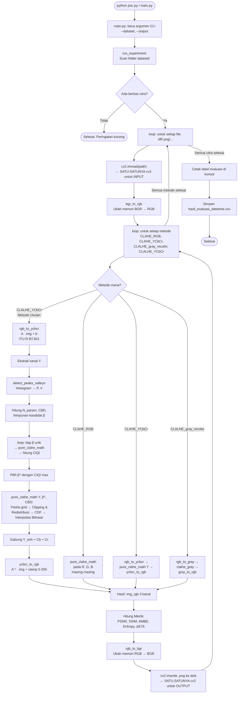

# Arsitektur & Alur Eksekusi Program CLALHE Pure Math

## Struktur Direktori

```
ProjectPCD/
├── poc.py                  ← Entry-point kompatibel
├── main.py                 ← Runner eksperimen utama
└── src/
    ├── __init__.py         ← Paket interface (facade)
    ├── color_space.py      ← Lapisan 1: Transformasi warna
    ├── clahe_math.py       ← Lapisan 2: Engine inti CLAHE murni
    ├── clalhe.py           ← Lapisan 3: Algoritma CLALHE adaptif
    ├── enhancement.py      ← Lapisan 4: Pipeline metode
    └── metrics.py          ← Lapisan 5: Evaluasi kualitas
```

---

## Fungsi Tiap File

### `poc.py` — Entry-Point Kompatibel
**Peran:** File ini *tidak melakukan komputasi apapun*. Isinya hanya impor dari `main.py` dan `src/`, sehingga pengguna yang sudah terbiasa menjalankan `python poc.py` tetap bisa menggunakannya tanpa perubahan.
```
poc.py → memanggil → main.py → menggunakan → src/*
```

---

### `main.py` — Orkestrator Eksperimen
**Peran:** Mengatur seluruh siklus hidup eksperimen dari awal hingga akhir.  
Berisi 3 fungsi utama:

| Fungsi | Tugas |
|:---|:---|
| `process_image(path)` | Memproses **1 citra** dengan **semua metode**, mengumpulkan metrik, menyimpan PNG ke disk |
| `run_experiment(dataset, output)` | Iterasi seluruh citra di folder `dataset/`, memanggil `process_image` untuk tiap citra, mencetak tabel & menyimpan CSV |
| `main()` | Membaca argumen CLI (`--dataset`, `--output`) lalu memanggil `run_experiment` |

> [!NOTE]
> `main.py` adalah **satu-satunya** file yang menggunakan `cv2` — hanya untuk `cv2.imread()` dan `cv2.imwrite()`.

---

### `src/__init__.py` — Pintu Masuk Paket
**Peran:** Bertindak sebagai *facade* (pintu gerbang tunggal) ke seluruh modul dalam paket `src`. Mengekspor semua fungsi publik sehingga kode lain cukup menulis `from src import clalhe_ycbcr` tanpa perlu tahu di file mana fungsi itu berada.

---

### `src/color_space.py` — Lapisan Transformasi Warna
**Peran:** Mendefinisikan **matematika transformasi ruang warna** ITU-R BT.601 secara eksplisit menggunakan perkalian matriks NumPy murni.

| Komponen | Keterangan |
|:---|:---|
| `MAT_RGB2YCBCR` | Matriks affine 3x3 transformasi maju R'G'B' ke Y'CbCr |
| `MAT_YCBCR2RGB` | Matriks invers 3x3 transformasi balik Y'CbCr ke R'G'B' |
| `rgb_to_ycbcr(img)` | Dot product: `img @ A.T`, kemudian tambah offset `[0, 128, 128]` |
| `ycbcr_to_rgb(img)` | Kurangi offset, dot product: `img @ A_inv.T`, kemudian clamp `[0, 255]` |
| `rgb_to_gray(img)` | Proyeksi skalar: `Y = 0.299R + 0.587G + 0.114B` |
| `bgr_to_rgb`, `rgb_to_bgr` | Membalik urutan kanal memori untuk kompatibilitas disk I/O dengan `cv2` |

---

### `src/clahe_math.py` — Engine Inti CLAHE Murni
**Peran:** Implementasi **4 tahapan analitis CLAHE** dari nol, menggantikan kotak hitam `cv2.createCLAHE`.

Menerima: kanal skalar 2D + `clip_limit` + `grid_size`  
Mengembalikan: kanal skalar 2D hasil peningkatan kontras

**Empat tahapan eksekusi `pure_clahe_math`:**

1. **Partisi Spasial** — Membagi citra M×N menjadi gy×gx blok kontekstual
2. **Kliping & Redistribusi** — Untuk setiap blok: memotong histogram di atas ambang β, mendistribusikan kelebihan E secara seragam ke seluruh 256 bin
3. **Fungsi CDF Lokal** — Menghitung CDF kumulatif dari histogram yang sudah dimodifikasi, dinormalisasi ke `[0, 255]`, menghasilkan tabel pemetaan T(i,j)(k) untuk setiap blok
4. **Interpolasi Bilinear** — Untuk setiap piksel, nilai output diinterpolasi dari **4 pusat blok terdekat** menggunakan bobot (s, t) untuk menghindari efek kotak (*blocking artifact*)

---

### `src/clalhe.py` — Algoritma CLALHE Adaptif (Mohammed & Isa, 2025)
**Peran:** Lapisan "kecerdasan" yang menentukan **nilai clip limit optimal secara otomatis** untuk setiap citra.

| Fungsi | Tugas |
|:---|:---|
| `detect_peaks_valleys(hist)` | Memindai histogram 256 bin, mengekstrak himpunan P (puncak) dan V (lembah) |
| `clalhe_gray(Y)` | Algoritma utama: menentukan N_param, CBD, kandidat β, lalu mencari β* optimal |

**Logika optimasi di `clalhe_gray`:**
```
Untuk setiap kandidat β unik:
    → Jalankan pure_clahe_math(Y, clip_limit=β)
    → Hitung CIQI = (PSNR + Entropy) / AMBE
    → Simpan β jika CIQI terbesar
→ Kembalikan hasil pure_clahe_math(Y, clip_limit=β_optimal)
```

---

### `src/enhancement.py` — Pipeline Metode Peningkatan Kontras
**Peran:** Menggabungkan semua komponen di atas menjadi **4 fungsi metode** yang siap dibandingkan. Menerima citra RGB, mengembalikan citra RGB.

| Fungsi | Alur Singkat |
|:---|:---|
| `clahe_rgb` | R,G,B → CLAHE(R), CLAHE(G), CLAHE(B) → gabung kembali |
| `clahe_ycbcr` | RGB→YCbCr → CLAHE(Y) → Cb & Cr tetap → YCbCr→RGB |
| `clalhe_gray_recolor` | RGB→Gray → CLALHE(Gray) → duplikat 3 kanal |
| `clalhe_ycbcr` *(Metode Usulan)* | RGB→YCbCr → **CLALHE(Y)** → Cb & Cr tetap → YCbCr→RGB |

---

### `src/metrics.py` — Modul Evaluasi Kualitas
**Peran:** Implementasi analitis murni 5 metrik kualitas citra objektif.

| Fungsi | Rumus |
|:---|:---|
| `compute_psnr(a, b)` | 10 log10(255² / MSE) |
| `compute_ssim(a, b)` | Structural Similarity Index (mendekati 1 = lebih baik) |
| `compute_ambe(a, b)` | |μ_a - μ_b| |
| `compute_entropy(img)` | -Σ p_i log2(p_i) (Shannon entropy) |
| `delta_e_76(a, b)` | RGB→XYZ→LAB → jarak Euclidean ΔE*76 |

---

## Step-by-Step Alur Eksekusi Program



---

## Posisi cv2 dalam Keseluruhan Program

> [!IMPORTANT]
> `cv2` hanya digunakan pada **2 baris kode** di seluruh program, keduanya di `main.py`:
> - **Input:** `cv2.imread(path)` — membaca bytes file gambar dari disk ke array NumPy
> - **Output:** `cv2.imwrite(out_path, img_bgr)` — menulis array NumPy kembali ke bytes file gambar di disk
>
> Semua komputasi di antaranya (transformasi warna, histograming, clipping, CDF, interpolasi, metrik) adalah **NumPy murni** sesuai formulasi matematika analitis.
